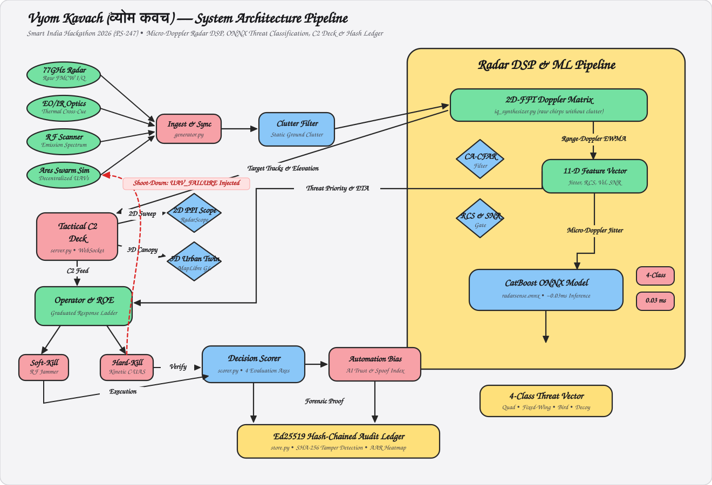

# Vyom Kavach (व्योम कवच) — AI & Multi-Sensor Counter-UAS Threat Recognition, Swarm Interdiction & C2 Training Platform

> **Next-Generation 77GHz FMCW Micro-Doppler Radar DSP, Decentralized Autonomous Swarm Defense, 3D Urban Canopy C2 Digital Twin & Auditable Operator Certification System for Air Defense & Homeland Security Forces**

[Live Web Application](https://vyom-kavach-ps247.vercel.app/) • [API Documentation (Swagger)](https://vyomkavach-api-sw9g.onrender.com/docs) • [Architectural Specifications](DESIGN.md) • [Deployment Guide (Vercel & Render)](DEPLOYMENT.md)

---

## 🎯 Problem Statement (SIH 2026 — PS 247)

**Border Security Forces & Air Defense Operations**: Asymmetric unmanned aerial threats—including commercial quadcopters retrofitted for standoff payload release, low-radar-cross-section (RCS) fixed-wing loitering munitions, and coordinated decentralized swarm incursions—present acute challenges to critical sovereign infrastructure, military forward posts, and civilian population centers.

Key operational, technical, and cognitive bottlenecks in modern C-UAS operations include:

1. **Micro-Doppler Radar Blindspots**: Low-altitude micro-UAVs exhibit Radar Cross Sections (RCS) comparable to birds and urban clutter (σ ≈ 0.001 – 0.01 m²). Conventional 2D radar systems fail to distinguish hostile weaponized drones from biological clutter without frequency-domain micro-Doppler rotor blade modulation analysis.
2. **Autonomous Swarm Saturation**: Hostile swarms utilize decentralized flocking (Boids / potential-field algorithms) and adaptive recovery. When a single drone is neutralized, the swarm dynamically re-routes along evasive trajectories, overwhelming single-target kinetic defensive rings.
3. **Cognitive Automation Bias & ROE Failures**: Operators facing extreme time pressure either suffer from *automation bias* (blindly trusting faulty AI suggestions, particularly against spoofed electronic decoys) or *procedural failure* (skipping graduated warning protocols in sensitive civilian No-Engage buffer zones).
4. **Lack of Auditable Training & Evidentiary Provenance**: Existing simulators use pre-scripted video playback or idealized kinematic formulas, lacking physical signal synthesis, rigorous time-to-impact scoring, and tamper-evident cryptographic ledgers for military After-Action Reviews (AAR).

---

## 💡 Solution Overview: Vyom Kavach (व्योम कवच)

**Vyom Kavach** is an enterprise-grade, microservices-ready, multi-sensor air defense command-and-control (C2) simulation and operator certification platform engineered specifically for **Smart India Hackathon (SIH 2026) — Problem Statement PS 247**.

Vyom Kavach replicates the full tactical lifecycle: from raw 77GHz FMCW radar I/Q synthesis and 2D Range-Doppler CA-CFAR detection to real-time CatBoost ONNX inference, 3D urban canopy tactical visualization, multi-role crew coordination, and decentralized swarm interdiction. Every engagement decision is graded by an auditable decision-tree scorer and permanently sealed in an append-only Ed25519 cryptographic ledger with hash-chain verification, ensuring complete post-mission forensic auditability.

---

## 📱 Platform Showcase & Core UI Screens

```
┌────────────────────────────────────────────────────────────────────────────────────────┐
│                              VYOM KAVACH UNIFIED COMMAND DECK                          │
│  [2D PPI Radar Scope]     [3D Airspace Dome]     [3D Urban Canopy]     [AAR Telemetry]  │
├────────────────────────────────────────────────────────────────────────────────────────┤
│  🎯 77GHz FMCW Micro-Doppler   🛰️ Multi-Sensor Fusion Array   ⚔️ Swarm Interdiction    │
│  • Rotor Jitter: 42.1 Hz      • EO/IR Thermal Cross-Cue      • Ares-X Boids Flocking   │
│  • CA-CFAR SNR: +18.4 dB       • RF Emission Fingerprint      • Live Reallocation Link │
├────────────────────────────────────────────────────────────────────────────────────────┤
│  ⚡ Graduated Response Ladder           🔐 Ed25519 Tamper-Evident Session Ledger        │
│  • Warn → Soft-Kill → Hard-Kill        • Cryptographic Hash-Chained Verification       │
│  • No-Engage Buffer Protection (0% Col) • Automated Certification Status Badge (Pass)   │
└────────────────────────────────────────────────────────────────────────────────────────┘
```

---

## ⚡ Key Unique Selling Propositions (USPs)

| Feature | Legacy C-UAS Simulators / Manual Spreadsheets | Vyom Kavach (PS 247) |
| :--- | :--- | :--- |
| **Physics-Based Radar DSP** | Look-up tables or pre-baked animations; zero true frequency-domain signal processing. | Native **77GHz FMCW I/Q raw signal synthesizer** → **2D Range-Doppler FFT** → **CA-CFAR filter** extracting real rotor micro-Doppler modulation signatures. |
| **Sub-Millisecond ML Inference** | Slow cloud-dependent models or static rule-based heuristics (>500 ms latency). | Production **CatBoost 4-Class ONNX model** (`radarsense.onnx`) executing in **~0.03 ms**, classifying Quadcopters, Fixed-Wing UAVs, Biologicals (Birds), and Decoys. |
| **3D Urban Canopy Digital Twin** | Flat 2D vector top-down maps with zero elevation or structural occlusion awareness. | Dual-mode **2D Tactical PPI** + **3D WebGL Airspace Dome** + **3D Urban Canopy (MapLibre GL)** with real-time building height occlusion and contact de-confliction. |
| **Decentralized Swarm Interdiction** | Pre-recorded rigid linear paths; no dynamic reaction to drone shoot-downs. | Live **Ares-X Swarm Kinematics Engine**: neutralizing a swarm node triggers deterministic real-time evasive re-routing and convergent re-allocation. |
| **Graduated Response ROE Ladder** | Binary "Click to Kill" button; no legal or rules-of-engagement boundaries. | Structured 4-tier doctrine: **Warn** → **Soft-Kill** (Directional Jammer) → **Hard-Kill** (Kinetic Laser/Missile) with active **No-Engage Zones** (hospitals, schools). |
| **Automation Bias Calibration** | AI hints treated as ground truth; zero measurement of operator over-reliance. | Real-time **Automation Bias Tracking Index** measuring whether the operator blindly followed incorrect hints against spoofed decoys. |
| **Cryptographic AAR Audit Ledger** | Mutable SQL tables or local CSV files susceptible to retroactive alteration. | **Append-only Ed25519 hash-chained audit ledger** with SHA-256 block hashes, ensuring **100% tamper detection** across scoring and action logs. |
| **Air-Gapped Verifiable Scenarios** | Network-dependent drill downloads prone to interception or tampering. | **HMAC-SHA256 signed drill packs** verifiable offline without internet access for air-gapped military deployments. |
| **Multi-Terminal Crew Chain** | Single-user monolithic exercise screen. | Dedicated **3-Operator Distributed Terminal** (`Surveillance Detector` → `Sensor Classifier` → `Engagement Authority`) with configurable relay comms latency. |

---

## 🔬 Architectural Deep-Dive

<div align="center">



*Figure 1: Vyom Kavach End-to-End System Architecture Pipeline — Multi-Sensor Radar DSP, Micro-Doppler Extraction, CatBoost ONNX Inference, C2 Operator Interdiction & Ed25519 Cryptographic Audit Ledger.*

</div>

```
                        VYOM KAVACH SYSTEM TOPOLOGY

  [ Tactical Operators ] ──► [ React 19 Tactical Deck ] ──► [ FastAPI Async Engine ]
   • Radar Surveillance TOC    • Dark Military TOC Aesthetic   • Python 3.11+ Core
   • Classification Analyst    • 4px Grid HSL Design Tokens    • Stateless REST API
   • Engagement Authority      • 2D PPI / 3D Three.js Dome     • Sub-Millisecond Bridge
                                              │
                                              ▼
  [ Defense Hardware & DSP ] ◄─── [ Domain Engines & C2 ] ───► [ Persistent Storage ]
   • 77GHz FMCW Synthesizer       • Decision-Tree Scorer        • Ed25519 Hash Ledger
   • Range-Doppler 2D-FFT         • Graduated ROE Ladder        • SQLite Session Store
   • CA-CFAR Detector             • Multi-Sensor Fusion Core    • Signed Drill Packs
   • CatBoost ONNX Engine         • Ares-X Swarm Sim Link       • Spatial Heatmaps
   • Multi-Sensor (EO/IR, RF)     • Red-Team Adaptive Injector  • Unit Leaderboards
```

### 1. 77GHz FMCW Micro-Doppler Radar DSP Pipeline
- **I/Q Synthesis**: `ml_bridge/iq_synthesizer.py` generates raw in-phase and quadrature radar chirps conditioning on target radial velocity, physical radar cross section (RCS), and high-frequency blade rotation harmonics.
- **Range-Doppler Processing**: `radar_dsp.py` executes 2D Fast Fourier Transforms (FFT) followed by a 2D Cell-Averaging Constant False Alarm Rate (CA-CFAR) detector, calculating true Doppler velocity, SNR (dB), and micro-Doppler spectral bandwidth/jitter.
- **Physical Miss Modeling**: At low signal-to-noise ratios, contacts drop out of the radar picture naturally, providing realistic sensor degradation under night, storm, and urban clutter conditions.

### 2. Real-Time CatBoost ONNX Classification Engine
- **Inference Speed**: Compiled directly into Open Neural Network Exchange (`radarsense.onnx`), running on `onnxruntime` with an inference latency of **~0.03 ms**.
- **Physical Feature Space**: Evaluates 11 physics-conditioned dimensions (velocity, range, azimuth, elevation, Doppler jitter, RCS estimate, SNR, multi-sensor confidence).
- **Adversarial Spoofing Resistance**: Exercises cross-cueing against electronic spoofing (decoys configured to emulate bird radar cross sections), rewarding operators who cross-verify with EO/IR thermal channels.

### 3. 3D Tactical PPI, Urban Canopy & Airspace Dome
- **2D Tactical PPI**: Range rings, 360° azimuth sweep line, graduated threat blips, and velocity vector lines.
- **3D Airspace Dome**: Hemispherical WebGL canvas rendered with Three.js, projecting true target altitudes, trajectory arcs, and weapon engagement envelopes.
- **3D Urban Canopy (MapLibre GL)**: 3D extruded urban structures modeling line-of-sight elevation occlusion, terrain masking, and swarm launch pad stagger.

### 4. Decentralized Autonomous Swarm Kinematics (`ares` Sim)
- Integrates the `ares` multi-UAV decentralized flocking simulator directly into the C2 loop.
- Swarm units dynamically navigate around terrain obstacles and converge on target coordinates.
- Engaging a swarm member mid-flight deterministically injects a `UAV_FAILURE` event, causing the remaining swarm drones to disperse, execute evasive maneuvers, and re-allocate target priorities live.

### 5. Auditable Decision-Tree Scorer & ROE Engine
- Graded across four independent mathematical axes (0–100 weighted index):
  1. **Detection Window (20%)**: Full credit within 20s of emergence; decays linearly.
  2. **Classification Precision (25%)**: Exact 4-class match (full credit) vs. hostile/friendly bucket match (half credit).
  3. **ROE Compliance (35%)**: Evaluates adherence to the graduated response ladder (`Warn` → `Soft-Kill` → `Hard-Kill`) and penalizes kinetic strikes inside civilian No-Engage buffer zones.
  4. **Timeliness to Impact (20%)**: Scores engagement latency against each hostile contact's closing velocity time-to-impact ETA.

### 6. Cryptographic Provenance & Tamper-Evident Ledger
- Every completed drill calculates an Ed25519 cryptographic signature and a forward-linked SHA-256 block hash covering all score axes, timestamps, and trainee actions:

  ```text
  Block_Hash = SHA256(Prev_Hash ∥ Trainee_ID ∥ Scores ∥ Timestamp)
  ```
- Retrospective modification of any session row detectably breaks all subsequent hashes in the chain, verifiable via `GET /api/audit/verify_chain`.
- Scripted scenarios are distributed as **HMAC-SHA256 signed packs**, verifiable completely offline for air-gapped defense deployments.

---

## 📂 Repository Structure

```
ps247-drone/
├── app/                               # React 19 Tactical TOC Web Application
│   ├── src/
│   │   ├── api/                       # REST & WebSocket Client Hooks
│   │   ├── components/domain/         # 2D PPI Radar, 3D Airspace Dome, 3D Urban Canopy
│   │   ├── pages/                     # Trainer Scope, AAR Archive, Instructor, Team
│   │   └── ui/                        # Military TOC Component Library (Dark Void Tokens)
│   ├── package.json                   # React 19, MapLibre GL, Three.js, Tailwind v4
│   └── vite.config.ts                 # Tactical App Vite Bundler
├── landing/                           # 3D Procedural Drone Flight Showcase
│   ├── src/world/                     # Three.js / R3F terrain, atmosphere, procedural drone
│   └── vite.config.ts                 # Base /landing-static/ bundler configuration
├── scenario_engine/                   # Scenario Generation & Cryptographic Signing
│   ├── generator.py                   # Day/night/terrain/sensor degradation engine
│   ├── scripted.py                    # Scripted military drill library
│   └── signing.py                     # HMAC-SHA256 offline scenario pack signing
├── scoring_engine/                    # Auditable Decision-Tree & ROE Scorer
│   └── scorer.py                      # Detection, Classification, ROE & Timeliness grading
├── aar_dashboard/                     # After-Action Review Engine & Hash Ledger
│   ├── store.py                       # Ed25519 hash-chained session audit database
│   └── aar.html                       # Standalone high-density telemetry dashboard
├── ml_bridge/                         # DSP Pipeline, ONNX Model Runner & Swarm Sim
│   ├── iq_synthesizer.py              # 77GHz FMCW raw I/Q signal generator
│   ├── radar_classifier.py            # CA-CFAR DSP + CatBoost ONNX inference (~0.03ms)
│   ├── multi_sensor.py                # EO/IR, RF, and Acoustic sensor channels
│   └── swarm_kinematics.py            # Ares-X multi-UAV decentralized flocking link
├── radar_classification/              # Standalone Radar Analytics Deep-Research Suite
├── swarm_simulation/                  # Multi-agent autonomous swarm flocking simulation
├── docs/                              # Architectural blueprints & system specifications
│   └── assets/                        # High-precision architectural flow diagrams (SVG)
├── server.py                          # Production FastAPI Server with CORS & Static Routing
├── start.bat                          # One-command automated Windows runner
├── start.sh                           # One-command automated POSIX runner
├── Dockerfile                         # Production Multi-Stage Container specification
├── render.yaml                        # 1-Click Render Cloud Blueprint configuration
├── vercel.json                        # Vercel Edge CDN routing & API reverse-proxy rules
└── DEPLOYMENT.md                      # Comprehensive Vercel & Render deployment guide
```

---

## 🚀 Live Deployment & Environments

- **Production Web Application (Vercel)**: [https://vyom-kavach-ps247.vercel.app](https://vyom-kavach-ps247.vercel.app/)
- **Production Backend API (Render)**: [https://vyomkavach-api-sw9g.onrender.com](https://vyomkavach-api-sw9g.onrender.com/)
- **Interactive Swagger Documentation**: [https://vyomkavach-api-sw9g.onrender.com/docs](https://vyomkavach-api-sw9g.onrender.com/docs)
- **API Health Check**: [https://vyomkavach-api-sw9g.onrender.com/api/model/status](https://vyomkavach-api-sw9g.onrender.com/api/model/status)

---

## 🛠️ Local Installation & Development

### 1. Prerequisites
- **Python**: 3.10 or higher
- **Node.js**: 20.x or higher
- **Git**

### 2. Automated One-Command Launch (Zero Configuration)

Vyom Kavach includes an automated setup script that creates a virtual environment, installs Python/Node dependencies, builds production bundles, picks an open port (8090 → 8099), and opens your browser:

* **Windows**: Double-click [`start.bat`](start.bat) (or run in terminal: `.\start.bat`)
* **Linux / macOS**: Run `chmod +x start.sh && ./start.sh`

### 3. Manual Developer Setup

```bash
# Clone the repository
git clone https://github.com/AncientWarRior13/Vyom-Kavach-ps247.git
cd Vyom-Kavach-ps247

# Create and activate virtual environment
python -m venv .venv
source .venv/bin/activate       # On Windows: .venv\Scripts\activate

# Install dependencies
pip install -r requirements.txt

# Build frontends
cd app && npm install && npm run build && cd ..
cd landing && npm install && npm run build && cd ..

# Start the FastAPI server (Port 8090)
python -m uvicorn server:app --host 127.0.0.1 --port 8090 --reload
```

---

## 👥 Tactical Roles & Multi-Operator Command Gateway

Vyom Kavach supports distributed multi-operator crew exercises over simulated relay communications latency (`/team`):

| Role | Operational Scope | Permitted Actions | Command Handoff Rule |
| :--- | :--- | :--- | :--- |
| **Surveillance / Detection Radar** | Monitors wide-area 2D PPI scope and 3D urban canopy for raw radar returns. | Detect, Tag, Designate Contact Track. | Designates contact; triggers 5s comms relay delay to Classifier. |
| **Sensor Classification Analyst** | Cross-cues 77GHz micro-Doppler radar, EO/IR thermal, and RF channels. | Request AI Hint, Read Sensors, Assign Classification. | Requires prior detection; handoff unlocks Engagement Authority after relay delay. |
| **Engagement Authority (ROE)** | Evaluates threat closing velocity, collateral No-Engage zones, and rules of engagement. | Issue Warning, Soft-Kill Jamming, Hold-to-Confirm Hard-Kill. | Enforces graduated response ladder; graded on ROE compliance. |
| **Red-Team Tactical Instructor** | Supervises active sessions via `/instructor` console. | Inject Live Threat, Trigger Sensor Outage, Override Weather. | Injects dynamic anomalies into running trainee scenarios in real-time. |

---

## 🔐 Security, Compliance & Tactical Guardrails

- **Human-in-the-Loop Engagement Safeguard**: All kinetic hard-kill fires require a continuous 600ms hold-to-confirm input, physically preventing accidental release.
- **Host & Cross-Origin Isolation**: Protected by default against unauthorized network exposure; production LAN deployments require explicit opt-in via `VYOMKAVACH_ALLOW_REMOTE=1`.
- **Statutory Collateral Protection**: Demarcates critical civilian buffer zones (hospitals, schools, high-density residential sectors) as strict No-Engage boundaries.
- **Air-Gapped Cryptographic Audit**: Cryptographically signs drill packs using HMAC-SHA256, allowing field deployment and verification in secure air-gapped facilities without internet access.

---

## 🏆 SIH 2026 Evaluation Reference (PS 247 Match)

| SIH PS 247 Benchmark Requirement | Vyom Kavach Implementation & Compliance | Verified File Reference |
| :--- | :--- | :--- |
| **Drone & Swarm Threat Recognition** | 77GHz FMCW Range-Doppler DSP + CatBoost ONNX inference classifying UAVs, Birds, Aircraft, Decoys in 0.03ms. | [`ml_bridge/radar_classifier.py`](ml_bridge/radar_classifier.py) |
| **Multi-UAV Swarm Simulation** | Decentralized Ares-X Boids flocking with dynamic mid-flight loss recovery and convergent evasion. | [`ml_bridge/swarm_kinematics.py`](ml_bridge/swarm_kinematics.py) |
| **3D Tactical PPI & Urban Visualization** | 2D PPI Radar Scope, 3D Hemispherical Airspace Dome (Three.js), and 3D Urban Canopy (MapLibre GL). | [`app/src/components/domain/`](app/src/components/domain/) |
| **Rules of Engagement (ROE) Scorer** | 4-Tier Graduated Response ladder (`Warn` → `Soft-Kill` → `Hard-Kill`) with No-Engage Zone collateral checks. | [`scoring_engine/scorer.py`](scoring_engine/scorer.py) |
| **Multi-Sensor Data Fusion** | Real-time cross-cueing across 77GHz Radar, EO/IR shape profiling, RF electronic emission, and Acoustic arrays. | [`ml_bridge/multi_sensor.py`](ml_bridge/multi_sensor.py) |
| **After-Action Review (AAR) Dashboard** | Longitudinal trainee score trends, weakness error taxonomy, spatial missed-contact heatmaps, and certification status. | [`aar_dashboard/aar.html`](aar_dashboard/aar.html) |
| **Cryptographic Provenance & Audit** | Ed25519 hash-chained session ledger and offline-verifiable HMAC-SHA256 signed scenario packages. | [`aar_dashboard/store.py`](aar_dashboard/store.py) |
| **Multi-Operator Crew Coordination** | Distributed 3-operator tactical roles with realistic relay communication latencies. | [`trainer_frontend/team.html`](trainer_frontend/team.html) |

---

*Developed with tactical precision and defense-grade engineering rigor for the Smart India Hackathon 2026.*  
*Built by Team **JSON 0xFF**.*
