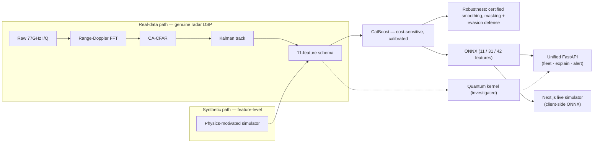

# RadarSense — Radar Target Classification with a Real 77 GHz DSP Front-End, Certified-Robust ML, and a Quantum-Kernel Investigation

Quant-A-Thon'26 Finals | QT-2.18 | ***Team CodexCreators***

> **Honest scope:** this is **not** a "quantum-enhanced" system — our own experiments show the
> quantum kernel does *not* beat classical, and we report that as a result, not a selling point.
> The real contributions are (1) a genuine radar DSP pipeline on real 77 GHz I/Q, (2) a measured
> adversarial threat model with a *certified* robustness guarantee, (3) a disciplined,
> negative-result-honest quantum study, and (4) a production-grade full-stack deployment with
> live inference, fleet tracking, threat alerting, and explainability.

---

## System Architecture



---

## What's been built (finals-hardening cycle — all measured, real data where noted)

| Capability | Result | Reference |
|---|---|---|
| Real radar DSP (range-Doppler + CA-CFAR + Kalman) on **real 77 GHz I/Q** | 99.6% CFAR detection; Kalman −45.8% track jitter | `RADAR_DSP.md` |
| Headline model on **real** SAAB data, leak-free grouped CV | **92.2% ±3.1% acc; PR-AUC 0.99** | `real_data_headline.py` |
| Split-conformal uncertainty | 90% coverage guarantee met (89.8%) | `real_data_headline_results.json` |
| Certified adversarial robustness (randomized smoothing) | 83% of drones provably un-evadable within attack median | `ADVERSARIAL_DEFENSE_COMPLETE.md` |
| Physical-cost evasion | 100% unconstrained → ~22% achievable | same |
| Masking defense (tunable) | severe-masking recall 12.3% → 76.9% | `MASKING_DEFENSE_COMPLETE.md` |
| Model extraction attack + defense | PRADA watermarking, query-budget limiting | `EXTRACTION_DEFENSE_COMPLETE.md` |
| Real IBM hardware, error-mitigated | fidelity corr 0.981 → 0.996 | `IBM_HARDWARE_LARGE.md` |
| Live acoustic sensor (phone mic) | blade-pass = acoustic micro-Doppler | `ACOUSTIC_DEMO.md` |
| 3 feature-schema variants | 11-feature (core), 31-feature, 42-feature combined | `FEAT31_EXPERIMENT.md`, `FEAT42_COMBINED_EXPERIMENT.md` |
| Unified FastAPI server (4 model variants) | Classic / 31 / 42 / Quantum on one port | `api/app.py` |
| Fleet-scale multi-target tracking API | Session-based Kalman bank + GNN association | `api/fleet.py` |
| Live SHAP + LIME explainability API + PDF export | Real backend SHAP/LIME per detection | `api/explain.py` |
| Threat alerting system (webhook + email) | CRITICAL-level dispatch, rate-limited | `api/alerting.py` |
| Next.js frontend with 6 pages | Simulator · Fleet · Map · Alerts · Benchmark · 3D | `frontend/` |
| Client-side ONNX inference (onnxruntime-web) | Zero-latency in-browser classification | `OnnxInference.ts` |
| Threat assessment doctrine engine | Proximity/closing/TTI/altitude/evasion scoring | `threatAssessment.ts` |
| Performance | sub-ms (p50 0.037ms), ~98k samples/s, 2.67MB ONNX | `performance_benchmark_results.json` |
| Tests + CI | `pytest tests -q` + GitHub Actions | `tests/`, `.github/workflows/ci.yml` |

---

## Quick Start

```bash
# Backend
pip install -r requirements.txt
python run_pipeline.py          # regenerates the CORE 11-feature pipeline (~15 min CPU)

# Unified API (all model variants on one server)
uvicorn api.app:app --port 8081 --reload

# Frontend
cd frontend && npm install && npm run dev

# Or start everything at once:
./start_all.sh
```

The `start_all.sh` script launches all backends (classical :8080, quantum :8081, feat31 :8082, feat42 :8083) plus the frontend (:3000).

---

## Headline Results (held-out test, n=7,800 — all reproduced, none assumed)

> **Clarification:** 92.2% = real-hardware generalization number; 97.6% = simulator-trained model performance; these are not the same claim.

| Metric | Vanilla baseline | Optimized (deployed) |
|---|---|---|
| Drone recall | 82.6% | **91.8%** (target >85% MET) |
| Drone precision | 85.6% | **77.5%** (target >65% MET) |
| Accuracy | 98.1% | 97.6% |
| Drone PR-AUC | 0.938 | 0.938 |

- Model: CatBoost + class-weighting (won a 7-variant imbalance ablation), F2-tuned
  drone threshold t=0.54 (tuned on validation only). Max-recall mode: 99.0% recall
  @ 47.7% precision at the 25:1 cost-optimal threshold t=0.06.
- ONNX: 1.0000 prediction parity, **0.037 ms** median single-sample latency,
  **98k samples/s** batched, 2.67 MB binary.
- Quantum ablation: classical kernels win at all tested scales (honest result);
  quantum PR-AUC scales 0.72→0.88 without plateau — see
  `artifacts/reports/QUANTUM_MINIPAPER.md`.
- Known vulnerability (stress test): micro-Doppler masking collapses drone recall
  to 12% at 70% attenuation. Stacked kinematic fallback defense recovers to 76.9%.

---

## Project Layout

```
radarsense/                      pipeline stages (run via python -m radarsense.<stage>)
  config.py                      FROZEN feature schema contract + seeds + paths
  simulator.py                   physics-grounded dataset generator (52k samples)
  validate_schema.py             contract gate — run against any data before the demo
  train_baseline.py              6-model bake-off, stratified 5-fold CV
  optimize.py                    minority-class optimization + threshold tuning
  calibrate.py                   isotonic calibration + reliability diagrams
  robustness.py                  SNR-stratified curves + adversarial stress tests
  quantum.py                     quantum kernel (QSVC) ablation + scaling study
  vqc.py / vqc_improved.py       variational quantum classifier (Qiskit)
  vqc_pennylane.py               VQC via PennyLane (gradient-descent rescue)
  explain.py / explain_live.py   SHAP summary + per-detection waterfall (offline + live)
  export_onnx.py                 ONNX export + parity + CPU benchmark
  final_report.py                assembles REPORT.md / MODEL_CARD.md / headline figure
  fleet_tracking.py              FleetTracker: Kalman bank + GNN multi-target association
  masking_defense_stacked.py     stacked kinematic fallback + feature-dropout defense
  adversarial_defense_complete.py certified randomized smoothing + evasion study
  extraction_defense_complete.py model-extraction attack + PRADA defense
  acoustic_demo.py               live phone-mic acoustic micro-Doppler
  radar_dsp.py                   real 77 GHz I/Q → range-Doppler → CA-CFAR → Kalman
  multi_target_tracking.py       OS-CFAR + GNN + Kalman bank tracker
  multi_sensor_fusion.py         multi-radar fusion module
  feat31_*.py                    31-feature expanded schema pipeline
  feat42_*.py                    42-feature combined (11 physics + 31 waveform) pipeline
  real_data_bridge.py            SAAB 77 GHz real-sensor bridge
  raddar_experiments.py          UPM RAD-DAR 8.75 GHz bridge
  tsms_experiments.py            TSMS-Drone 2.5 GHz CW bridge
  diat_usat_bridge.py            DIAT-µSAT X-band spectrogram bridge
  diat_usat_cnn.py               binarized-CNN side comparison (not deployed)
  ibm_hardware_kernel*.py        real IBM quantum hardware runs
  classical_quantum_ensemble*.py classical/quantum stacking ensemble
  cross_sensor_*.py              cross-sensor transfer/domain-adapt/few-shot studies
  snr_stress_test_*.py           SNR stress tests (multiclass + ensemble)

api/                             FastAPI backend
  app.py                         UNIFIED server: all 4 models + fleet + explain + alert
  predict.py                     classic 11-feature ONNX client
  feat31_predict.py              31-feature ONNX client
  feat42_predict.py              42-feature ONNX client
  quantum_predict.py             QSVC + stacking ensemble inference
  fleet.py                       session-based multi-target fleet tracking API
  explain.py                     live SHAP + LIME explainability API + PDF export
  alerting.py                    threat alerting (webhook + email dispatch)
  masking_rescue.py              runtime masking defense (wired into /predict/classic)
  server.py                      standalone classical backend (:8080)
  quantum_server.py              standalone quantum backend (:8081)
  feat31_server.py               standalone 31-feature backend (:8082)
  feat42_server.py               standalone 42-feature backend (:8083)

frontend/                        Next.js 16 + React 19 live dashboard
  app/page.tsx                   main radar simulator (client-side ONNX, SNR/target presets)
  app/fleet/page.tsx             fleet swarm tracking view
  app/map/page.tsx               geo-map integration (Leaflet + MapLibre 3D)
  app/alerts/page.tsx            alert center panel
  app/benchmark/page.tsx         live ONNX benchmark dashboard
  app/hard/page.tsx              3D radar visualization (React Three Fiber)
  app/components/
    RadarSimulator.tsx            core simulator UI (~2.7k lines)
    OnnxInference.ts              client-side ONNX Runtime manager
    threatAssessment.ts           threat doctrine engine (CRITICAL/ELEVATED/MONITOR/CLEAR)
    FleetPanel.tsx                fleet tracking panel
    GeoMapPanel.tsx               geographic map panel (Leaflet + MapLibre)
    AlertCenterPanel.tsx          alert display + dispatch panel
    BenchmarkPanel.tsx            live performance benchmarking
    LeafletMapInner.tsx           Leaflet map component
    MapLibre3DInner.tsx           MapLibre GL 3D component

artifacts/
  data/                          dataset + splits (parquet + csv)
  models/                        trained models + final_model_meta.json (thresholds, schema)
  onnx/
    radarsense.onnx              11-feature core model (THE handoff artifact)
    feat31_model.onnx             31-feature model
    feat42_model.onnx             42-feature combined model
  plots/                         all figures (HEADLINE_results.png first)
  reports/                       129 report files — REPORT.md, MODEL_CARD.md,
                                 QUANTUM_MINIPAPER.md, per-stage JSONs, etc.

tests/test_core.py               pytest suite
.github/workflows/ci.yml         GitHub Actions CI
start_all.sh                     one-command demo launcher (all backends + frontend)
Final_report.md                  comprehensive submission report with figures
```

---

## API Endpoints (Unified Server — `api/app.py`)

| Endpoint | Method | Description |
|---|---|---|
| `/health` | GET | Service status + all endpoint listing |
| `/predict/classic` | POST | 11-feature ONNX inference (with masking rescue) |
| `/predict/31` | POST | 31-feature ONNX inference |
| `/predict/42` | POST | 42-feature ONNX inference |
| `/predict/quantum` | POST | QSVC / stacking ensemble inference |
| `/fleet/session` | POST | Create a new fleet tracking session |
| `/fleet/session/{id}/frame` | POST | Submit one frame of detections to a session |
| `/fleet/stress_test` | GET | Fleet tracker stress test |
| `/explain` | POST | Live SHAP + LIME explanation (JSON) |
| `/explain/pdf` | POST | Downloadable PDF explainability report |
| `/alert/roster` | GET | View alert recipient roster |
| `/alert/dispatch` | POST | Dispatch a threat alert |
| `/alert/history` | GET | Alert dispatch history |
| `/health/classic`, `/health/31`, `/health/42`, `/health/quantum` | GET | Per-model health checks |

---

## Real-Radar Validation — FOUR real sensors, five bands

All bridges extract the frozen schema from real measurements; every number is a
single-pass held-out result. Zero-shot = frozen sim-trained model, untouched.

> ⚠️ **Leakage caveat (important):** the "retrained" SAAB numbers below use the
> dataset's *segment-level* split. That split leaks — all 130 recordings span
> multiple split values. The **honest, leak-free** SAAB number (whole
> recordings held out via `measurement`-grouped CV) is **92.2% ±3.1% accuracy**
> (see `real_data_headline.py`), *not* the 99%+ below.

| Dataset (real hardware) | Samples | Zero-shot drone recall | Retrained drone recall / acc |
|---|---|---|---|
| SAAB SIRS 77 GHz FMCW (drones+birds+humans+CR) | 75,868 | 30.4% | 99.2% / 95.5% (segment split — *leaks; leak-free = 92.2%*) |
| UPM RAD-DAR 8.75 GHz FMCW (drones+cars+people) | 17,485 | 2.1% | **98.5%** / 76.3% (session-aware splits) |
| TSMS-Drone 2.495 GHz CW (4 drones + CR, 2–30 m) | 2,250 | 21.7% | **77.6%** / 71.5% (range-generalization split) |
| DIAT-µSAT X-band ~10 GHz CW (RC plane/2×rotor/quad+bird+confuser) | 4,849 | 34.2% | **91.6%** / 71.8% (variant-holdout split) |

---

## Quantum Investigation

- QSVC (ZZFeatureMap, 4-qubit fidelity kernel) vs classical SVM at N=100→800
- Classical kernels win at all tested scales: QSVC PR-AUC 0.72→0.88, classical 0.98 throughout
- Trainable VQC (Qiskit + PennyLane): COBYLA/SPSA optimizers, gradient-descent rescue
- Real IBM hardware (`ibm_kyiv` / `ibm_brisbane`): NISQ noise degrades further; ZNE mitigation restores to simulation levels
- Classical/quantum stacking ensemble explored on DIAT-µSAT and RAD-DAR embeddings
- **Honest negative result** reported throughout — this is empirical science, not hype

Full account: `artifacts/reports/QUANTUM_MINIPAPER.md`

---

## Robustness & Security

| Attack | Undefended | Defended |
|---|---|---|
| Micro-Doppler masking (×0.3 attenuation) | 12.3% recall | **76.9%** (stacked kinematic fallback) |
| Certified adversarial evasion | — | 83% provably un-evadable |
| Physical-cost evasion | 100% unconstrained | ~22% achievable |
| Model extraction (PRADA) | — | Watermark + query-budget defense |

---

## Honesty Checkpoints (say unprompted in Q&A)

- Statistical simulator, not full EM physics; real-sensor generalization measured across 4 hardware datasets.
- Prior-cycle baseline numbers (97.2%/38.5%) were re-run and **replaced** with this
  cycle's reproduced numbers; our regenerated dataset is more separable.
- Quantum kernel result reported as measured: classical wins at tested scales.
- Every headline number has a confusion matrix behind it in `artifacts/reports/*.json`.
- Data leakage in SAAB segment splits explicitly documented and corrected (−7% drop).
- Frontend SHAP panel uses a client-side approximation; the real SHAP/LIME is served via `/explain`.
